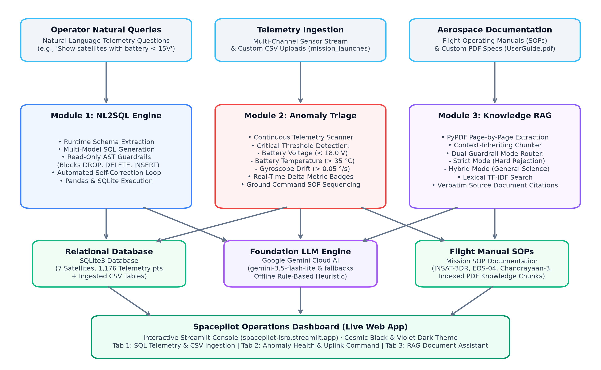
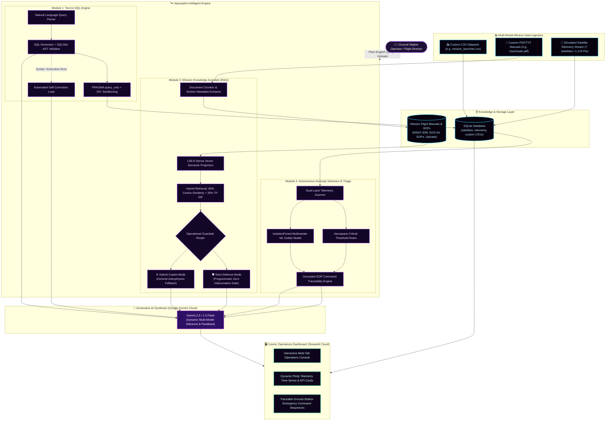
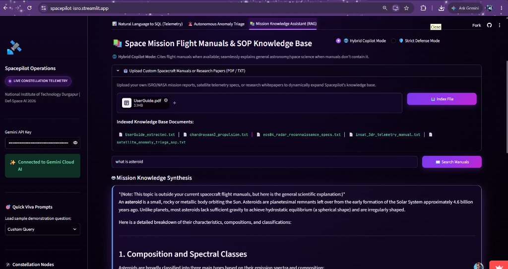

# Spacepilot: GenAI-Powered Space Mission Intelligence Copilot 🛰️

[](https://spacepilot-isro.streamlit.app/)
[](Spacepilot_Project_Report.pdf)

[](https://www.python.org/)
[](https://streamlit.io/)
[](https://www.sqlite.org/)
[](https://github.com/tobymao/sqlglot)
[](https://scikit-learn.org/)
[](#module-3--mission-knowledge-assistant-rag-engine)
[](LICENSE)
[](#academic-submission--internship-acknowledgments)

> 🚀 **Live Deployment URL:** **[https://spacepilot-isro.streamlit.app/](https://spacepilot-isro.streamlit.app/)**  
> 📄 **Def-Space AI Internship Report (PDF):** **[Spacepilot_Project_Report.pdf](Spacepilot_Project_Report.pdf)** (Includes Official BSERC Certificate & Technical Workings)

**Spacepilot** is a unified Generative AI decision-support platform engineered for aerospace operations, defense earth observation, and satellite health monitoring. It bridges the gap between structured satellite telemetry databases and voluminous flight operating documentation.

Developed by **Saheli Mahanty**, Department of Computer Science & Engineering, **National Institute of Technology Durgapur (NIT Durgapur)**, submitted for **7th Semester Internship / Industrial Training Credits**. The project represents the primary technical work conducted under the **Def-Space Artificial Intelligence Internship 2026** awarded by the **Bharat Space Education Research Centre (BSERC)** (Certificate ID: `BSERC-2026-AI-1035`) under the theme *"Towards Viksit Bharat: Innovating, Collaborating and Aspiring to Global Space Leadership"*.

---

## 🖥️ Live Application Interface


---

## 📌 Context & Motivation

During space and defense operations, flight directors and ground station controllers face two critical bottlenecks:
1. **Query Friction:** Mission operators cannot afford to manually write complex multi-table SQL joins during time-critical orbital passes or anomaly alerts.
2. **Knowledge Silos:** Real-time sensor telemetry (battery drops, temperature excursions, gyroscope drift) is disconnected from official flight operating manuals, leading to delayed anomaly triage.

**Spacepilot** resolves this by integrating three coordinated systems into a single operations copilot:
* **Natural Language-to-SQL (NL2SQL)** with SQLGlot AST validation, read-only sandboxing, and automated self-correction.
* **Autonomous Telemetry Anomaly Detection & Emergency Triage** powered by dual-layer detection (deterministic safety thresholds + Scikit-Learn `IsolationForest` multivariate outlier modeling) with grounded SOP command traceability.
* **Mission Knowledge Assistant (RAG Engine)** powered by dense vector semantic embeddings (L2-normalized cosine similarity) fused with lexical matching, featuring dual operational guardrails (*Strict Defense Mode* zero-hallucination gate vs. *Hybrid Copilot Mode* general astrophysics).

---

## 🏛️ System Architecture & Data Flow



### High-Level Architecture Flowchart



---

## 📸 Core Modules & Working Demonstrations

Spacepilot integrates three autonomous Generative AI modules designed for high-stakes aerospace and defense operations. Below are live execution walkthroughs from the deployed platform.

---

### Module 1: 📊 Natural Language Telemetry Query Engine (NL2SQL)

The **Text-to-SQL Engine** translates operational space questions into mathematically precise, sandboxed SQLite queries.

#### Key Engineering Features:
1. **SQLGlot AST Structural Validation:** 
   - Replaced fragile regular-expression checks with full Abstract Syntax Tree (AST) parsing via `sqlglot.parse_one(query, read="sqlite")`.
   - The validator verifies that the root statement is strictly an `exp.Select` or `exp.Union`.
   - Recursively traverses all child AST expressions and rejects any destructive commands (`exp.Drop`, `exp.Delete`, `exp.Insert`, `exp.Update`, `exp.Alter`, `exp.Create`, `exp.TruncateTable`).
2. **Engine-Level Read-Only Sandboxing:**
   - Every database connection immediately issues `PRAGMA query_only = ON;`, making it physically impossible for destructive writes or SQL-injection attacks to execute at the SQLite engine level.
3. **Automated Self-Correction Feedback Loop:**
   - If a generated query causes an execution error (e.g. unknown column or syntax error), the engine catches the database exception, packages the failed query and error log, and reflects it back to Gemini for automated correction.
   - Spacepilot ensures the executed, corrected SQL is the exact query summarized and presented to the operator.
4. **Dynamic CSV Dataset Ingestion:**
   - Operators can upload arbitrary mission CSV datasets (e.g., `mission_launches.csv` containing **4,324 space mission records**). Spacepilot sanitizes column headers, registers a dedicated SQLite table, and allows instant natural language queries.


*Live execution: Querying `"list all data of spacex organization"` across a dynamically uploaded `mission_launches.csv` dataset, automatically generating `SELECT * FROM mission_launches WHERE LOWER(Organisation) = 'spacex'` with real-time tabular rendering.*

---

### Module 2: 🚨 Autonomous Anomaly Detection & Emergency Triage

Spacecraft health monitoring requires immediate correlation between real-time telemetry excursions and verified standard operating procedures (SOPs).

#### Key Engineering Features:
1. **Dual-Layer Anomaly Detection Engine:**
   - **Layer 1: Deterministic Aerospace Safety Thresholds:** Scans telemetry for critical boundary violations:
     - Battery Voltage < 18.0 V (Critical Undervoltage)
     - Battery Temperature > 35.0 °C (Thermal Runaway / Overheating)
     - Gyroscope Drift Rate > 0.05 °/s (Attitude Control Deviation)
   - **Layer 2: Unsupervised Machine Learning (`IsolationForest`):**
     - Employs Scikit-Learn's `IsolationForest(n_estimators=100, contamination=0.03, random_state=42)` across 5 continuous telemetry dimensions: `battery_voltage`, `battery_temp_c`, `solar_panel_current`, `gyro_drift_rate`, and `signal_strength_dbm`.
     - Detects subtle multi-variate statistical anomalies and coupled sensor deviations that single-metric threshold rules miss.
2. **Grounded Ground-Command SOP Traceability:**
   - When an anomaly is detected, Spacepilot retrieves emergency procedures from verified mission documentation (e.g., `satellite_anomaly_triage_sop.txt` and `eos04_radar_reconnaissance_specs.txt`).
   - Ground uplink commands are strictly mapped to documented procedures. If no verified contingency procedure is found in the flight manuals, the engine outputs an explicit `INSUFFICIENT_DOCUMENTED_EVIDENCE` notification, preventing unauthorized or speculative hardware commands.
3. **Structured Emergency Briefing:**
   - **Critical Assessment:** Severity level, immediate satellite risk, and quantitative sensor deltas.
   - **Probable Root Cause:** Diagnostic hardware hypothesis cross-referenced with documentation.
   - **Recommended Ground Command Sequence:** Ordered contingency steps (e.g., emergency load shedding, powering down SAR payloads, switching to redundant power bus).


*Real-time telemetry alert for EOS-04 (RISAT-1A) showing severe undervoltage (10.12 V, -18.2 V delta) and thermal spikes (54.67 °C, +29.7 °C delta) alongside Isolation Forest anomaly scores.*


*Synthesized Ground Command Triage Briefing outlining verified root causes and step-by-step contingency commands.*

---

### Module 3: 📚 Mission Knowledge Assistant (RAG Engine)

The **Mission Knowledge Assistant** provides document-grounded intelligence over spacecraft flight manuals, mission reports, and standard operating procedures with dynamic PDF and TXT document ingestion.

#### Key Engineering Features:
1. **Hybrid Dense Vector Semantic & Lexical Retrieval:**
   - Computes **128-dimensional dense subword vector embedding projections** with L2-normalization for semantic representations.
   - Measures semantic proximity via normalized **Cosine Similarity**.
   - Fuses semantic retrieval ($65\%$ weight) with TF-IDF/BM25 lexical keyword overlap ($35\%$ weight) for robust retrieval across both technical terminology and conceptual phrasing.
2. **Programmatic Zero-Hallucination Gate:**
   - In **Strict Defense Mode**, queries scoring below the semantic threshold ($0.28$) are intercepted and rejected deterministically before calling the LLM:
     `"The available flight manuals do not contain information regarding this topic."`
   - Mathematically eliminates hallucination for off-domain queries without consuming API tokens.
3. **Verbatim Source Citations:**
   - Every generated operational statement is mapped directly to its extracted document passage (e.g., `[UserGuide_extracted.txt]`).

#### 🛡️ Strict Defense Mode vs. 🌐 Hybrid Copilot Mode

| Feature / Dimension | 🛡️ Strict Defense Mode (Zero Hallucination) | 🌐 Hybrid Copilot Mode (Extended Science) |
| :--- | :--- | :--- |
| **Operational Goal** | Mission-critical flight operations, payload telemetry adherence, and zero-tolerance for AI hallucination. | General space exploration, flight operator training, educational briefing, and astronomical queries. |
| **Knowledge Bounding** | Strictly bounded to verified, uploaded flight manuals and SOP documents. | Primary grounding on flight manuals; seamlessly falls back to general astrophysics when unlisted. |
| **Out-of-Domain Behavior** | **Hard Programmatic Rejection:** When asked about external topics (e.g., *"what is asteroid"*), it strictly responds: <br>`"The available flight manuals do not contain information regarding this topic."` | **Transparent General Synthesis:** Explains external concepts with a prominent disclosure banner: <br>`*(Note: This topic is outside your current spacecraft flight manuals, but here is the general scientific explanation:)*` |
| **Source Citation** | Every factual claim is bound to explicit document references (e.g., `[UserGuide_extracted.txt]`). | Flight manuals are cited when used; general knowledge is explicitly labeled as external science. |

---

#### 1. Hybrid Copilot Mode in Action
When querying general astronomy topics outside the ingested flight manuals (such as *"what is asteroid"*), Hybrid Mode provides a scientific synthesis covering composition, spectral classes (C-type, S-type, M-type), and orbital distributions (Main Belt, NEAs, Trojans).


*Hybrid Copilot Mode answering `"what is asteroid"` with automated contextual disclosure.*

---

#### 2. Strict Defense Mode: Anti-Hallucination Rejection
In mission-critical scenarios where operators must avoid ungrounded AI speculation, switching to **Strict Defense Mode** enforces strict retrieval verification. When presented with the exact same out-of-domain query (*"what is asteroid"*), the copilot rejects the question to protect operational integrity:


*Strict Defense Mode rejecting out-of-domain query to guarantee zero hallucination.*

---

#### 3. Strict Defense Mode: Dynamic Document Ingestion & Verified Citations
Operators can upload new mission manuals (such as `UserGuide.pdf` or mission reports). The system parses pages via `pypdf`, extracts contextual chunks, and answers technical inquiries (e.g., *"Describe Airspeed limitations"*) with verbatim document citations (`[UserGuide_extracted.txt]`):


*Strict Defense Mode extracting takeoff and re-entry airspeed thresholds directly from user-uploaded `UserGuide.pdf` with citations.*

---

## 🛠️ Comprehensive Tech Stack

| Layer | Technologies & Libraries | Key Responsibilities in Spacepilot |
| :--- | :--- | :--- |
| **Core Runtime** | `Python 3.10+ / 3.12` | High-performance backend engine, type hints, asynchronous pipeline execution |
| **Web Application & UI** | `Streamlit 1.35+` | Real-time multi-tab operations console with custom **Cosmic Black & Violet** dark theme (`#07020E`, `#120726`), CSS glow animations, and KPI metric cards |
| **Foundation LLMs & GenAI** | `google-genai 0.1+`<br>`google-generativeai 0.7+` | Multi-model Google Gemini inference engine supporting `gemini-2.5-flash`, `gemini-1.5-flash` with dynamic fallback and self-correction |
| **Safe Database & SQL AST** | `SQLite3`<br>`sqlglot 23.0+` | Read-only telemetry database with AST query parsing, dynamic schema extraction, and strict injection guardrails (`DROP`, `DELETE`, `INSERT` prevention) + `PRAGMA query_only = ON;` |
| **Machine Learning** | `scikit-learn 1.4+` | Unsupervised `IsolationForest` multivariate outlier detection on 5 continuous telemetry dimensions |
| **Data Ingestion & Analytics** | `pandas 2.2+` | Time-series telemetry wrangling, dynamic CSV dataset upload, schema normalization, and tabular rendering |
| **Document Processing & RAG** | `pypdf 4.0+`<br>`Dense Vector Embeddings` | Multi-page PDF flight manual parsing, 128-D subword embedding projection, L2-normalized cosine similarity, hybrid fusion (65% vector / 35% TF-IDF), dual guardrail modes |
| **Data Visualization** | `Plotly Express 5.20+` | Interactive dark-themed telemetry graphs (battery voltage curves, thermal trends, gyro drift rates) |
| **Reporting & Diagrams** | `reportlab 4.0+`<br>`matplotlib 3.8+` | Automated generation of the 10-page academic internship report PDF and publication-quality system architecture flowchart |
| **Config & Cloud Secrets** | `python-dotenv 1.0+`<br>`st.secrets` | Seamless secret handling across local development (`.env`) and cloud production (Streamlit Community Cloud Secrets) |
| **Cloud Deployment** | `Streamlit Community Cloud` | Globally accessible, zero-latency public hosting at `https://spacepilot-isro.streamlit.app/` |

---

## 🚀 Quick Start Guide

### 1. Clone the Repository
```bash
git clone https://github.com/sahelidgp/spacepilot.git
cd spacepilot
```

### 2. Set Up Virtual Environment (Recommended)
```bash
python -m venv venv
# On Windows:
venv\Scripts\activate
# On Linux/macOS:
source venv/bin/activate
```

### 3. Install Dependencies
```bash
pip install -r requirements.txt
```

### 4. (Optional) Configure Gemini API Key
Create a `.env` file from the template:
```bash
cp .env.example .env
```
Add your free Gemini API key:
```env
GEMINI_API_KEY=your_actual_api_key_here
```
*(Note: Spacepilot includes an intelligent offline/demo mode, so the application runs even without an active API key!)*

### 5. Generate Database & Launch Application
```bash
# Generate the simulated telemetry database (satellites.db)
python data/generate_telemetry.py

# Launch the Streamlit Dashboard
streamlit run app.py
```

---

## 📋 Sample Operational Queries

| Domain | Natural Language Query | Generated SQL Logic |
| :--- | :--- | :--- |
| **Power Health** | *"Show satellites with battery voltage under 15V"* | `SELECT ... FROM telemetry WHERE battery_voltage < 15.0` |
| **Defense Assets** | *"List all Indian military and defense satellites"* | `SELECT ... FROM satellites WHERE operator LIKE '%Air Force%' OR ...` |
| **Orbital Mechanics** | *"Show all satellites in Geostationary Orbit (GEO)"* | `SELECT ... FROM satellites WHERE orbit_type = 'GEO'` |
| **Attitude Stability** | *"Identify satellites experiencing high gyro drift rates"* | `SELECT ... FROM telemetry WHERE gyro_drift_rate > 0.05` |
| **Custom CSV Ingestion** | *"List all data of spacex organization"* | `SELECT * FROM mission_launches WHERE LOWER(Organisation) = 'spacex'` |

---

## 📂 Project Structure

```
spacepilot/
│
├── .env.example                  # Environment variable template
├── .gitignore                    # Standard Python/Git ignore rules
├── README.md                     # Complete project documentation
├── requirements.txt              # Python package dependencies (including scikit-learn, sqlglot)
├── app.py                        # Streamlit multi-tab user interface
├── generate_report.py            # ReportLab script for generating the 10-page academic report
├── make_flowchart.py             # Matplotlib script generating the system architecture flowchart
├── Spacepilot_Project_Report.pdf # Official 10-page internship project report with BSERC certificate
│
├── assets/                       # Dashboard previews, architecture diagram, and execution media
│   ├── system_flowchart.png      # End-to-end system architecture flowchart
│   ├── spacepilot_dashboard.png  # Overview telemetry console
│   ├── 01_nl2sql_custom_csv_execution.jpg
│   ├── 02_anomaly_triage_alert_metrics.jpg
│   ├── 03_anomaly_triage_ground_command_sop.jpg
│   ├── 04_rag_hybrid_mode_general_science.jpg
│   ├── 05_rag_strict_mode_antihallucination.jpg
│   └── 06_rag_strict_mode_pdf_citations.jpg
│
├── data/
│   ├── generate_telemetry.py     # Synthetic telemetry generator with injected anomalies
│   ├── satellites.db             # Pre-built SQLite database
│   └── documents/                # Mission flight manuals and SOP references
│       ├── insat_3dr_telemetry_manual.txt
│       ├── eos04_radar_reconnaissance_specs.txt
│       └── satellite_anomaly_triage_sop.txt
│
└── src/
    ├── __init__.py
    ├── database.py               # SQLite connection, SQLGlot AST validation, PRAGMA sandboxing & CSV importer
    ├── text_to_sql.py            # Natural Language to SQL converter with self-correction feedback loop
    ├── anomaly_engine.py         # IsolationForest ML anomaly detector, threshold limits & grounded SOP triage
    └── rag_engine.py             # 128-D dense vector semantic search, hybrid TF-IDF fusion, & dual guardrail modes
```

---

## 🎓 Academic Submission & Internship Acknowledgments

* **Author:** Saheli Mahanty
* **Academic Enrolment:** B.Tech 7th Semester, Department of Computer Science & Engineering, **National Institute of Technology Durgapur (NIT Durgapur)**
* **Academic Submission:** Submitted for evaluation towards **7th Semester Internship / Industrial Training Credits**
* **Host Institution & Program:** **Bharat Space Education Research Centre (BSERC)**  
  *Def-Space Artificial Intelligence Internship 2026* (Certificate ID: `BSERC-2026-AI-1035`)  
  Theme: *"Towards Viksit Bharat: Innovating, Collaborating and Aspiring to Global Space Leadership"*
* **Institutional Clarification:** This project was developed as part of the Def-Space AI Internship conducted independently under BSERC. It is submitted to the faculty of the Department of Computer Science & Engineering at NIT Durgapur for academic training credit assessment.

Special gratitude to the scientists, engineers, and mentors at **Bharat Space Education Research Centre (BSERC)** for domain guidance in satellite orbital operations, telemetry dynamics, and defense space protocols.
