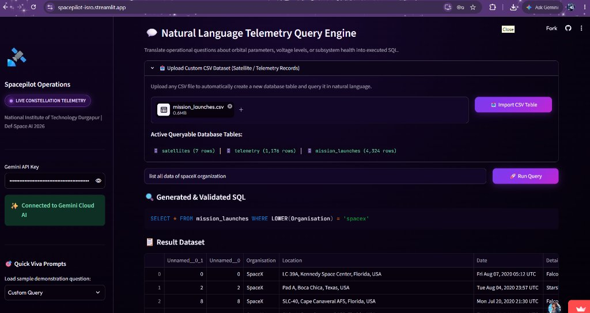
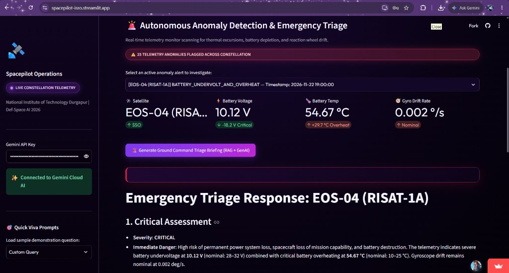
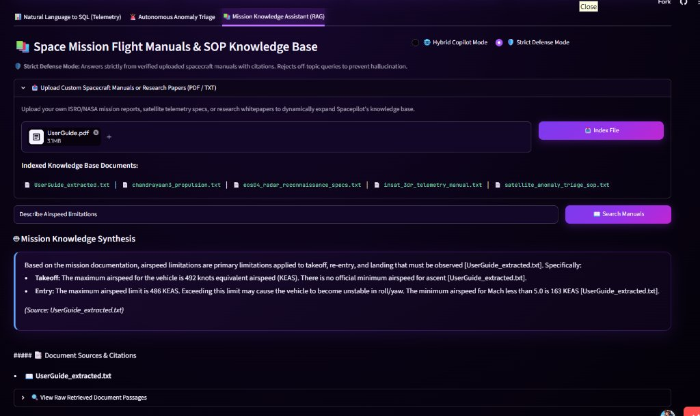

# Spacepilot: GenAI-Powered Space Mission Intelligence Copilot 🛰️

[](https://spacepilot-isro.streamlit.app/)

[](https://www.python.org/)
[](https://streamlit.io/)
[](https://www.sqlite.org/)
[](LICENSE)
[](#context--motivation)

> 🚀 **Live Deployment URL:** **[https://spacepilot-isro.streamlit.app/](https://spacepilot-isro.streamlit.app/)**

**Spacepilot** is a unified Generative AI decision-support platform engineered for aerospace operations, defense earth observation, and satellite health monitoring. It bridges the gap between structured satellite telemetry databases and voluminous flight operating documentation.

Developed by **Saheli Mahanty**, National Institute of Technology Durgapur, as a B.Tech Computer Science and Engineering Capstone, inspired by the **Def-Space Artificial Intelligence Programme 2026** organized by the **Bharat Space Education Research Centre (BSERC)** under the theme *"Towards Viksit Bharat: Innovating, Collaborating and Aspiring to Global Space Leadership"*.

---

## 🖥️ Live Application Interface


---

## 📌 Context & Motivation

During space and defense operations, flight directors and ground station controllers face two critical bottlenecks:
1. **Query Friction:** Mission operators cannot afford to manually write complex multi-table SQL joins during time-critical orbital passes or anomaly alerts.
2. **Knowledge Silos:** Real-time sensor telemetry (battery drops, temperature excursions, gyroscope drift) is disconnected from official flight operating manuals, leading to delayed anomaly triage.

**Spacepilot** resolves this by integrating **Natural Language-to-SQL (NL2SQL)**, **Automated Telemetry Anomaly Detection**, and **Retrieval-Augmented Generation (RAG)** into an intuitive mission copilot.

---

## 🏛️ System Architecture

```
                          [User Query / Plain English]
                                       │
            ┌──────────────────────────┼──────────────────────────┐
            ▼                          ▼                          ▼
  [Module 1: Text-to-SQL]   [Module 2: Anomaly Triage]   [Module 3: Mission RAG]
            │                          │                          │
   (Schema Linking &          (Z-Score & Threshold      (Document Ingestion,
    Safe SQL Generation)       Deviation Engine)         Chunking & Search)
            │                          │                          │
            ▼                          ▼                          ▼
   [Read-Only Validator]       [Live Telemetry Alert]     [Flight Manual SOPs]
            │                          │                          │
            ▼                          └────────────┬─────────────┘
  [SQLite Telemetry DB]                             ▼
  (7 Satellites / 1.1k pts)            [LLM Reasoning & Synthesis]
            │                         (Gemini 1.5 Flash / Local LLM)
            └──────────────────────────┬──────────────────────────┘
                                       ▼
                       [Interactive Streamlit Dashboard]
                    - Executed SQL & Live Data Tables
                    - Dynamic Plotly Telemetry Trend Lines
                    - Ground-Station Action Sequences & SOP Citations
```

---

## 📸 Core Modules & Working Demonstrations

Spacepilot integrates three autonomous Generative AI modules designed for high-stakes aerospace and defense operations. Below are live execution walkthroughs from the deployed platform.

---

### Module 1: 📊 Natural Language Telemetry Query Engine (NL2SQL)

The **Text-to-SQL Engine** translates operational space questions into mathematically precise, sandboxed SQLite queries.

* **How it Works:** 
  1. The LLM receives the live SQLite database schema along with operational table definitions.
  2. It generates optimized read-only SQL, bounded by strict AST safety filters that immediately abort destructive statements (`DROP`, `DELETE`, `INSERT`, `ALTER`).
  3. If a generated query encounters a syntax or runtime error, an automated **self-correction feedback loop** sends the database error back to Gemini to iteratively fix and rerun the query.
* **Dynamic CSV Dataset Ingestion:** 
  Operators can upload arbitrary mission CSV datasets (e.g., `mission_launches.csv` containing **4,324 space mission records**). Spacepilot dynamically normalizes column headers, creates dedicated SQLite tables, and exposes them to natural language querying in seconds.


*Live execution: Querying `"list all data of spacex organization"` across a dynamically uploaded `mission_launches.csv` dataset, automatically generating `SELECT * FROM mission_launches WHERE LOWER(Organisation) = 'spacex'` with real-time tabular rendering.*

---

### Module 2: 🚨 Autonomous Anomaly Detection & Emergency Triage Copilot

Spacecraft health monitoring requires immediate correlation between real-time telemetry spikes and official standard operating procedures (SOPs).

* **How it Works:**
  1. The anomaly engine continuously scans constellation telemetry streams across primary channels (battery voltage, battery temperature, solar panel currents, attitude gyroscope drift).
  2. Critical excursions are immediately flagged with color-coded delta metrics (e.g., **10.12 V** [$\downarrow -18.2\text{ V}$ Critical] and **54.67 °C** [$\uparrow +29.7\text{ }^\circ\text{C}$ Overheat]).
  3. When an operator triggers ground triage, the engine retrieves the corresponding emergency procedures from verified mission flight manuals (e.g., `satellite_anomaly_triage_sop.txt` and `eos04_radar_reconnaissance_specs.txt`).
  4. The LLM synthesizes an operational **Ground Command Triage Briefing** structured into:
     - **Critical Assessment:** Severity rating, immediate mission risks, and telemetry delta breakdown.
     - **Probable Root Cause:** Cross-referenced hardware diagnostics (e.g., secondary power bus short circuit, payload thermal runaway).
     - **Tactical Command Sequence:** Step-by-step ground-station uplink commands (e.g., emergency payload load-shedding, disabling active synthetic aperture radar, switching regulator to Secondary Redundant Bus-B).


*Real-time telemetry alert for EOS-04 (RISAT-1A) showing severe undervoltage and thermal spikes.*


*Synthesized Ground Command Triage Briefing outlining root causes and step-by-step contingency commands.*

---

### Module 3: 📚 Mission Knowledge Assistant (RAG Engine)

The **Mission Knowledge Assistant** enables conversational intelligence over technical manuals, satellite design specifications, and standard operating procedures with dynamic PDF/TXT document ingestion.

#### 🛡️ Strict Defense Mode vs. 🌐 Hybrid Copilot Mode

To ensure operational reliability during critical space missions, Spacepilot introduces dual operational guardrail modes:

| Feature / Dimension | 🛡️ Strict Defense Mode (Zero Hallucination) | 🌐 Hybrid Copilot Mode (Extended Science) |
| :--- | :--- | :--- |
| **Operational Goal** | Mission-critical flight operations, payload telemetry adherence, and zero-tolerance for AI hallucination. | General space exploration, flight operator training, educational briefing, and astronomical queries. |
| **Knowledge Bounding** | Strictly bounded to verified, uploaded flight manuals and SOP documents. | Primary grounding on flight manuals; seamlessly falls back to general astrophysics when unlisted. |
| **Out-of-Domain Query Behavior** | **Hard Rejection:** When asked about external topics (e.g., *"what is asteroid"*), it strictly responds: <br>`"The available flight manuals do not contain information regarding this topic."` | **Transparent General Synthesis:** Explains external concepts with a prominent disclosure banner: <br>`*(Note: This topic is outside your current spacecraft flight manuals, but here is the general scientific explanation:)*` |
| **Source Citation** | Every factual claim is bound to explicit document references (e.g., `[UserGuide_extracted.txt]`). | Flight manuals are cited when used; general knowledge is explicitly labeled as external science. |

---

#### 1. Hybrid Copilot Mode in Action
When querying general astronomy topics outside the ingested flight manuals (such as *"what is asteroid"*), Hybrid Mode provides a scientific synthesis covering composition, spectral classes (C-type, S-type, M-type), and orbital distributions (Main Belt, NEAs, Trojans).


*Hybrid Copilot Mode answering `"what is asteroid"` with automated contextual disclosure.*

---

#### 2. Strict Defense Mode: Anti-Hallucination Rejection
In mission-critical scenarios where operators must avoid ungrounded AI speculation, switching to **Strict Defense Mode** enforces strict retrieval verification. When presented with the exact same out-of-domain query (*"what is asteroid"*), the copilot rejects the question to protect operational integrity:


*Strict Defense Mode rejecting out-of-domain query to guarantee zero hallucination.*

---

#### 3. Strict Defense Mode: Dynamic Document Ingestion & Verified Citations
Operators can upload new mission manuals (such as `UserGuide.pdf` or mission reports). The system automatically parses pages via `pypdf`, extracts contextual chunks while preserving title metadata, and answers technical inquiries (e.g., *"Describe Airspeed limitations"*) with verbatim document citations (`[UserGuide_extracted.txt]`):


*Strict Defense Mode extracting takeoff and re-entry airspeed thresholds directly from user-uploaded `UserGuide.pdf` with citations.*

---

## 🛠️ Tech Stack

* **Language:** Python 3.10+
* **Frontend:** Streamlit
* **Database:** SQLite3 / Pandas
* **Generative AI & LLMs:** Google Gemini 1.5 Flash API (`google-genai` / `google-generativeai`)
* **Information Retrieval:** Custom Vector / Lexical Chunker & Retrieval Engine
* **Data Visualization:** Plotly Express

---

## 🚀 Quick Start Guide

### 1. Clone the Repository
```bash
git clone https://github.com/sahelidgp/spacepilot.git
cd spacepilot
```

### 2. Set Up Virtual Environment (Recommended)
```bash
python -m venv venv
# On Windows:
venv\Scripts\activate
# On Linux/macOS:
source venv/bin/activate
```

### 3. Install Dependencies
```bash
pip install -r requirements.txt
```

### 4. (Optional) Configure Gemini API Key
Create a `.env` file from the template:
```bash
cp .env.example .env
```
Add your free Gemini API key:
```env
GEMINI_API_KEY=your_actual_api_key_here
```
*(Note: Spacepilot includes an intelligent offline/demo mode, so the application runs even without an active API key!)*

### 5. Generate Database & Launch Application
```bash
# Generate the simulated telemetry database (satellites.db)
python data/generate_telemetry.py

# Launch the Streamlit Dashboard
streamlit run app.py
```

---

## 📋 Sample Viva Test Queries

| Domain | Natural Language Query | Generated SQL Logic |
| :--- | :--- | :--- |
| **Power Health** | *"Show satellites with battery voltage under 15V"* | `SELECT ... FROM telemetry WHERE battery_voltage < 15.0` |
| **Defense Assets** | *"List all Indian military and defense satellites"* | `SELECT ... FROM satellites WHERE operator LIKE '%Air Force%' OR ...` |
| **Orbital Mechanics** | *"Show all satellites in Geostationary Orbit (GEO)"* | `SELECT ... FROM satellites WHERE orbit_type = 'GEO'` |
| **Attitude Stability** | *"Identify satellites experiencing high gyro drift rates"* | `SELECT ... FROM telemetry WHERE gyro_drift_rate > 0.05` |

---

## 📂 Project Structure

```
spacepilot/
│
├── .env.example               # Environment variable template
├── .gitignore                 # Standard Python/Git ignore rules
├── README.md                  # Complete project documentation
├── requirements.txt           # Python package dependencies
├── app.py                     # Streamlit multi-tab user interface
│
├── assets/                    # Dashboard previews and live execution media
│   ├── spacepilot_dashboard.png
│   ├── 01_nl2sql_custom_csv_execution.jpg
│   ├── 02_anomaly_triage_alert_metrics.jpg
│   ├── 03_anomaly_triage_ground_command_sop.jpg
│   ├── 04_rag_hybrid_mode_general_science.jpg
│   ├── 05_rag_strict_mode_antihallucination.jpg
│   └── 06_rag_strict_mode_pdf_citations.jpg
│
├── data/
│   ├── generate_telemetry.py  # Synthetic telemetry generator with injected anomalies
│   ├── satellites.db          # Pre-built SQLite database
│   └── documents/             # Mission flight manuals and SOP references
│       ├── insat_3dr_telemetry_manual.txt
│       ├── eos04_radar_reconnaissance_specs.txt
│       └── satellite_anomaly_triage_sop.txt
│
└── src/
    ├── __init__.py
    ├── database.py            # SQLite connection, schema extractor, CSV ingestion & validator
    ├── text_to_sql.py         # Natural Language to SQL converter with self-correction
    ├── anomaly_engine.py      # Statistical anomaly scanner and triage engine
    └── rag_engine.py          # Document chunking, search, and cited Q&A
```

---

## 🎓 Academic Defense & Acknowledgments

This project serves as the final year capstone for the **Department of Computer Science & Engineering, National Institute of Technology Durgapur**. 

Special acknowledgment to the **Bharat Space Education Research Centre (BSERC)** for the foundational domain exposure during the **Def-Space Artificial Intelligence Internship 2026**.

**Author:** Saheli Mahanty  
**Institution:** National Institute of Technology Durgapur  
